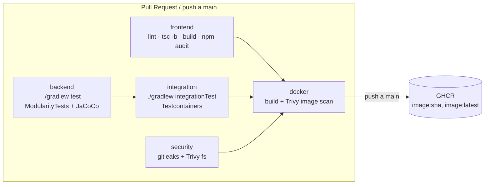
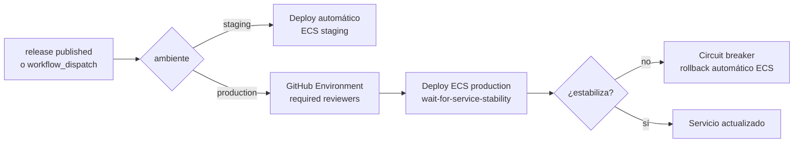

# 17 — CI/CD y despliegue

Implementa la Fase 4 de [16-readiness-plan.md](./16-readiness-plan.md). Cubre
pipeline de CI, build de imagen Docker, infraestructura Terraform (AWS) y
los runbooks de despliegue/rollback/backups.

## 1. Pipeline (CI)





Archivos: [.github/workflows/ci.yml](../.github/workflows/ci.yml),
[.github/workflows/deploy.yml](../.github/workflows/deploy.yml),
[.github/dependabot.yml](../.github/dependabot.yml).

### Jobs de `ci.yml`

| Job | Dispara | Qué hace | Bloquea el PR |
|---|---|---|---|
| `frontend` | PR, push main | `npm ci`, `lint`, `tsc -b`, `build`, `npm audit --audit-level=high` | Sí, excepto `npm audit` (`continue-on-error: true` temporal — ver §5) |
| `backend` | PR, push main | `./gradlew test` (incluye `ModularityTests`, excluye `@Tag("integration")`), sube JaCoCo + resultados JUnit como artifacts | Sí |
| `integration` | needs `backend` | `./gradlew integrationTest` (Testcontainers; Docker ya viene en `ubuntu-latest`) | Sí |
| `security` | PR, push main | `gitleaks-action` (secretos) + `trivy-action` modo `fs` (HIGH/CRITICAL) | Sí |
| `docker` | needs todos los anteriores | Build de imagen con `docker/build-push-action` + cache `gha`, `trivy-action` modo imagen (HIGH/CRITICAL); push a GHCR solo en push a `main` (tags `sha` y `latest`) | Sí |

Cada job declara `permissions:` mínimos (p. ej. `docker` solo tiene
`packages: write`, nadie tiene `contents: write`). `concurrency` cancela
runs viejos del mismo branch/PR. Todas las actions de terceros están
fijadas a su major version (`@v4`, `@v6`, `@0.28.0` para `trivy-action` que
no publica tags mayores estables) — Dependabot las mantiene actualizadas.

### Jobs de `deploy.yml`

- **`deploy-staging`**: `workflow_dispatch` con `environment=staging`
  (pensado para disparar automáticamente desde un paso posterior al merge
  a `main`, o manualmente). Usa el environment `staging` de GitHub (sin
  reviewers obligatorios).
- **`deploy-production`**: dispara con `release: published` o
  `workflow_dispatch` con `environment=production`. Usa el environment
  `production`, que **debe** tener "Required reviewers" configurado en
  *Settings → Environments → production* — esa es la aprobación manual.
- Autenticación 100% OIDC (`aws-actions/configure-aws-credentials` con
  `role-to-assume`), **sin access keys** de larga vida en secrets.
- Despliegue vía `amazon-ecs-render-task-definition` +
  `amazon-ecs-deploy-task-definition` con `wait-for-service-stability: true`.

## 2. Gates (qué debe estar en verde para mergear/desplegar)

1. PR a `main`: `frontend`, `backend`, `integration`, `security` y `docker`
   (build+scan) en verde. `npm audit` es informativo por ahora.
2. Push a `main`: igual, más el push de imagen a GHCR.
3. Deploy a `production`: imagen ya escaneada y en GHCR + aprobación humana
   en el environment `production` + `integrationTest` en verde en el commit
   desplegado.

## 3. Variables y secretos requeridos

### GitHub (Settings → Secrets and variables → Actions)

| Nombre | Tipo | Usado en | Notas |
|---|---|---|---|
| `AWS_DEPLOY_ROLE_ARN_STAGING` | secret | `deploy.yml` (staging) | ARN del rol OIDC — output `github_deploy_role_arn` de `infra/envs/staging` |
| `AWS_DEPLOY_ROLE_ARN_PRODUCTION` | secret | `deploy.yml` (production) | ARN del rol OIDC — output de `infra/envs/prod` |
| `ECR_REGISTRY` | secret | `deploy.yml` | `<account_id>.dkr.ecr.<region>.amazonaws.com` |
| `AWS_REGION` | variable (`vars.AWS_REGION`) | ambos workflows | default `us-east-1` si no se define |
| `GITHUB_TOKEN` | automático | `ci.yml` (GHCR push, gitleaks) | No configurar manualmente, lo provee GitHub |

GitHub Environments a crear (*Settings → Environments*):
- `staging`: sin protección (o con reviewers opcionales).
- `production`: **Required reviewers** habilitado (mínimo 1 persona).

### AWS (recursos y permisos a aprovisionar)

| Recurso | Dónde se crea | Notas |
|---|---|---|
| OIDC provider `token.actions.githubusercontent.com` | `infra/modules/app/github-oidc.tf` (una vez por cuenta) | Si ya existe por otro proyecto, poner `github_oidc_enabled=false` y reusar el provider existente vía `data` |
| Rol `assistance-{staging,prod}-github-deploy` | mismo módulo | Permisos mínimos: push a su repo ECR, `RegisterTaskDefinition`/`UpdateService` en ECS, `PassRole` solo a los roles de ejecución/tarea de ese ambiente |
| Repositorio ECR `assistance-checker` | `infra/modules/app/ecr.tf` | Scan on push habilitado, lifecycle policy (máx. 20 imágenes) |
| Secrets Manager: `DB_APP_PASSWORD`, `APP_PII_KEY`, master password RDS | `infra/modules/database/main.tf` | Generados por Terraform (`random_password`), inyectados a la task ECS como `secrets` (nunca como `environment` plano) |
| Bucket S3 + tabla DynamoDB para el backend de Terraform | `infra/bootstrap/README.md` (ejemplo comentado) | Crear una vez por cuenta antes de usar `backend "s3"` en `infra/envs/*` |
| Certificado ACM | fuera de este repo (o módulo nuevo) | `acm_certificate_arn` es variable de entrada de `infra/envs/{staging,prod,demo}` |

### Variables de entorno de la aplicación (contrato con backend)

Ver también `docker-compose.yml` (servicio `app`, profile `full`) y
`scripts/dev.sh` para los valores de desarrollo local.

| Variable | Perfil | Origen en AWS |
|---|---|---|
| `SPRING_PROFILES_ACTIVE` | todos | hardcoded en la task definition (`local`/`demo`/`prod`) |
| `DB_URL` | todos | Terraform (`jdbc:postgresql://<rds-endpoint>/<db>`) |
| `DB_MIGRATION_USER` / `DB_MIGRATION_PASSWORD` | todos | Secrets Manager (master user de RDS) |
| `DB_APP_USER` / `DB_APP_PASSWORD` | todos | Secrets Manager (`infra/modules/database`) |
| `APP_PII_KEY` | todos | Secrets Manager (`infra/modules/database`) |
| `AUTH_ISSUER_URI` | solo `prod` | Cognito user pool issuer — variable de Terraform, fuera del alcance de este agente (lo define quien cree el user pool) |
| `APP_JWT_SECRET` | `local`/`demo` | **Debe quedar vacío en `prod`**; la app debe abortar el arranque si no (responsabilidad del código de seguridad, no de infra) |
| `CORS_ORIGINS` | todos | Terraform, por ambiente |
| `SERVER_PORT` / `MANAGEMENT_PORT` | todos | `8080` / `8081`, fijos |

## 4. Cómo desplegar

### Staging (automático desde `main`)

1. Merge a `main` → `ci.yml` corre completo y publica
   `ghcr.io/<org>/<repo>:<sha>`.
2. Disparar `deploy.yml` con `workflow_dispatch` → `environment=staging`
   (o automatizarlo como job adicional que se dispare on `push` a `main`
   tras el éxito de `ci.yml`, pendiente de decisión del equipo sobre
   promover GHCR→ECR, ver §6).
3. El workflow renderiza `infra/ecs/task-definition.staging.json`,
   reemplaza la imagen y actualiza el servicio ECS esperando estabilidad.

### Producción (con aprobación)

1. Publicar un release en GitHub (tag semver, ej. `v1.2.0`) **o** disparar
   `deploy.yml` manualmente con `environment=production`.
2. El job `deploy-production` queda en espera hasta que un reviewer del
   environment `production` lo apruebe.
3. Tras aprobar, se despliega a ECS con `wait-for-service-stability`.

### Migraciones Flyway con múltiples tasks (riesgo documentado)

Flyway corre **dentro del arranque de cada task** de la app (no como job
separado), usando `DB_MIGRATION_USER`. Con `deployment_minimum_healthy_percent=100%`
y `maximum_percent=200%` puede haber hasta 2 tasks nuevas arrancando a la
vez durante un deploy:

- Flyway serializa con un **lock a nivel de BD** (tabla
  `flyway_schema_history`): solo una task aplica las migraciones
  pendientes, las demás esperan el lock y continúan su arranque normal.
- Riesgo real: si una migración es lenta (ej. reescribe una tabla grande),
  las tasks que esperan el lock pueden tardar en pasar el *readiness
  probe* y el deploy puede verse más lento de lo esperado, pero no debería
  fallar.
- Mitigación recomendada para v2 (no implementada aún): job de migración
  *one-off* (ECS `RunTask` con el mismo container, comando que solo corre
  Flyway) ejecutado **antes** de actualizar el servicio, desacoplando
  migración de arranque de réplicas.

### Rollback

1. **Automático**: `deployment_circuit_breaker` con `rollback=true`
   (habilitado en `infra/modules/app/ecs.tf` para prod/staging) revierte el
   servicio a la task definition anterior si el deployment no estabiliza.
2. **Manual**: re-ejecutar `deploy.yml` (`workflow_dispatch`) con
   `image_tag` = SHA de la última imagen conocida buena.
3. **Rollback de base de datos**: Flyway **no** hace rollback automático de
   migraciones aplicadas. Si una migración introduce un defecto, se corrige
   con una migración *forward-fix* nueva — **nunca** editar una migración
   ya aplicada en producción (rompe el checksum de Flyway).

## 5. `npm audit` no bloqueante (decisión temporal)

`npm audit --audit-level=high` corre con `continue-on-error: true` porque,
al momento de escribir esto, el árbol de dependencias de Vite/ESLint tiene
vulnerabilidades conocidas en *devDependencies* que no llegan al bundle de
producción (falsos positivos de severidad para este contexto). Queda
pendiente: (a) revisar el reporte real tras la primera corrida en CI, (b)
decidir con el equipo un umbral y un proceso de *allowlist* de CVEs
aceptados, y (c) quitar `continue-on-error` una vez que el log esté limpio
o las excepciones estén documentadas.

## 6. GHCR vs ECR (decisión y pendiente)

`ci.yml` publica a **GHCR** (`ghcr.io/<org>/<repo>`) porque es zero-config
con `GITHUB_TOKEN` y no requiere credenciales AWS en el job de CI (que no
necesita permisos de despliegue). `deploy.yml` y Terraform usan **ECR**
porque `amazon-ecs-deploy-task-definition` y las políticas IAM de ECS
están más integradas con ECR (sin necesidad de credenciales de pull
externas desde las tasks Fargate).

**Pendiente real**: falta el paso "promote" que copie la imagen de
GHCR→ECR tras pasar el gate de seguridad en `main` (ej. `crane copy` o
`docker buildx imagetools create`), o alternativamente simplificar
publicando *solo* a ECR desde `ci.yml` usando el rol OIDC de staging para
el job `docker` cuando el evento es push a `main`. Documentado aquí para
que el equipo decida antes de la primera ejecución de `deploy.yml` contra
AWS real.

## 7. Infraestructura (Terraform)

```
infra/
├── bootstrap/            Ejemplo comentado: bucket S3 + tabla DynamoDB para state remoto
├── modules/
│   ├── network/           VPC, subnets públicas/privadas, NAT, security groups
│   ├── database/          RDS Postgres 16, KMS, backups PITR, secrets, alarmas
│   └── app/               ALB (HTTPS + redirect 80→443), ECS Fargate, ECR,
│                          IAM (execution/task/GitHub OIDC), CloudWatch logs + alarmas
├── envs/
│   ├── staging/            1 NAT, RDS single-AZ t4g.micro, 1 task Fargate
│   ├── prod/               NAT por AZ, RDS Multi-AZ r6g.large, 2 tasks Fargate
│   └── demo/               Variante mínima reutilizando los mismos módulos
└── ecs/
    └── task-definition.{staging,production}.json   Plantillas para el workflow de deploy
```

Decisiones:

- **ECR** elegido sobre GHCR para el runtime de ECS (ver §6).
- **Un módulo `app` por ambiente** instancia su propio cluster ECS, ALB,
  repo ECR y rol OIDC — mantiene el *blast radius* de IAM acotado por
  ambiente (el rol de GitHub para staging no puede tocar producción).
- **Demo** reutiliza los mismos módulos con el tamaño mínimo en vez de un
  stack Lightsail separado, para no mantener dos paths de despliegue. Si
  el costo de ECS Fargate + RDS + ALB resulta excesivo para demos
  frecuentes, migrar `infra/envs/demo` a Lightsail Containers queda como
  alternativa documentada pero no implementada.
- **Backend de Terraform** (S3 + DynamoDB lock) está comentado en cada
  `versions.tf` — bootstrap manual de una sola vez, ver
  `infra/bootstrap/README.md`. Mientras tanto el estado es local.

### Validación corrida (sin acceso a una cuenta AWS real)

```
terraform fmt -recursive -diff   → aplicado (diffs de formato corregidos)
terraform init -backend=false    → OK en envs/{staging,prod,demo}
terraform validate               → "Success! The configuration is valid." en los 3 envs
```

No se corrió `terraform plan`/`apply` (requeriría credenciales AWS reales
y aprovisionaría recursos facturables). Antes de la primera aplicación
real: revisar nombres de dominio/ACM, decidir backend remoto, y rellenar
`container_image` con una imagen real ya publicada en ECR.

## 8. Backups y prueba de restauración (PITR)

RDS Postgres en `infra/modules/database` tiene:
- `backup_retention_days`: 35 en prod, 7 en staging/demo (dentro del rango
  7-35 exigido, con PITR automático de AWS dentro de esa ventana).
- `deletion_protection = true` en prod (bloquea `terraform destroy` /
  borrado accidental desde la consola).
- Cifrado KMS con rotación de llave habilitada.

### Runbook — prueba de restauración PITR (ejecutar trimestralmente)

1. Elegir un timestamp de prueba (ej. "hace 2 horas") dentro de la ventana
   de retención.
2. AWS Console/CLI → RDS → instancia origen → **Restore to point in time**
   → crear una instancia **nueva** (no reemplazar la existente) con
   identificador `assistance-<env>-pitr-test-<fecha>`.
3. Esperar a que la instancia restaurada esté `available` (Multi-AZ en
   prod tarda más).
4. Conectar con un cliente Postgres de prueba (nunca desde la app) y
   verificar:
   - `SELECT count(*) FROM event_raw;` razonable para el timestamp elegido.
   - `SELECT max(created_at) FROM event_raw;` ≤ timestamp elegido.
   - Tablas clave (`tenant`, `employee`, `kiosko`) con conteos esperados.
5. Documentar el resultado (tiempo de restauración, datos verificados) en
   el canal/issue de operaciones.
6. **Borrar la instancia de prueba** (no dejarla corriendo — cuesta dinero
   y es una copia de datos con PII).

Esto corresponde al Escenario C del [Runbook 4: Disaster recovery](./11-riesgos-y-runbooks.md#runbook-4-disaster-recovery)
(pérdida de datos parcial), adaptado aquí como ejercicio preventivo
programado en vez de reactivo.

## 9. Pendientes explícitos de esta fase

- `AUTH_ISSUER_URI` (Cognito) depende de que exista el user pool — fuera
  del alcance de este agente (Fase 1, Identidad y acceso).
- Promoción GHCR→ECR (§6) sin implementar; `deploy.yml` asume que la
  imagen ya existe en ECR con el tag correspondiente.
- `terraform plan`/`apply` reales no ejecutados (sin cuenta AWS en este
  entorno) — validar con el equipo antes del primer `apply`.
- CODEOWNERS no creado (opcional según el alcance); se puede añadir cuando
  se defina quién revisa infra vs backend vs frontend.
- Certificado ACM y dominios reales son variables de entrada, no
  provisionados aquí (Route 53 / ACM quedan fuera del alcance de Fase 4
  como se delimitó en el plan).
